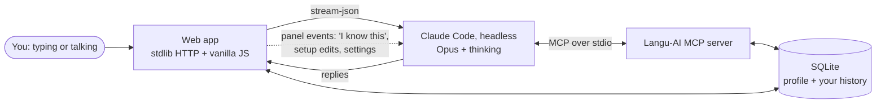

# Langu-AI

**Learn English by using it, not by studying it.** Langu-AI turns a Claude conversation (chat, role-play, text
adventure, debate) into a language lesson you never notice: the AI quietly weaves in vocabulary from the Cambridge
English Vocabulary Profile, tracks what you use right and wrong, and shows corrections as small notes beside your
message instead of interrupting the story.

No API key. No per-token bill. It runs on your Claude subscription through Claude Code, or inside Claude Desktop
as an MCP server.

```
┌────────────── you ──────────────┐        ┌─────────── side panel ───────────┐
│ "I put the phone in my pocket   │        │ Words for this session           │
│  calmly. What do you want       │  note  │  ● keep pace with sb/sth   C1    │
│  from us?"                      │◄──────►│  ○ down-to-earth           C1    │
│                                 │        │  ○ stop at nothing         C1    │
│ Elif: "Not paid enough, believe │        │ Story: Elif sent the 1st message │
│ me. That's the point."          │        │ Feedback: pocket → "my pocket"   │
└─────────────────────────────────┘        └──────────────────────────────────┘
```

## Why it is interesting as an agentic system

Langu-AI is a small, complete example of an **LLM agent that works through tools and keeps durable state**, with
no model API in sight.



- **The agent drives the app through MCP tools.** `log_turn` records what you used, files corrections, and notes
  new story facts, once per turn, before each reply. `get_words`, `lookup_word`, `set_word_status`, `get_grammar`
  and `settings` let it fetch practice material and react to what you say.
- **State lives outside the model.** A mastery model (spaced stages, one credit per day, wrong uses demote)
  decides what is "known", so a word you drill ten times in a row does not count as learned.
- **Two-way control.** Everything you click in the panel ("I know this", "Don't know it", a changed setting, an
  edited story fact) is queued as a `<panel>` event and delivered to the agent on its next turn, so you steer the
  agent without typing.
- **Memory that survives.** The agent maintains a list of story facts (who knows what, who holds what). If the
  Claude session can no longer be resumed, the app replays the transcript plus those notes into a fresh one.
- **Coherence by design.** The system prompt ranks priorities (make sense, follow the learner, then teach), gives
  per-character knowledge rules, and lets you speak outside the story with `((director's notes))`.
- **Zero dependencies.** Python 3.9 standard library only, hand-written MCP server (protocol 2024-11-05),
  SQLite in WAL mode, a single-file UI.

## Features

- **Modes:** chat, role-play, adventure, debate. Set who you play, who the AI plays, the setting, tone and rules.
- **Real vocabulary data:** every sense of a word is its own item with its own CEFR level (A1 to C2), as in the
  profile. American English by default, British optional. Words, phrases, phrasal verbs and idioms.
- **Grammar:** English Grammar Profile can-do statements woven into sessions.
- **You are in control:** mark a word known, unknown or not now. Dials for level, new items per session, review
  items, intensity (1 to 5), correction strictness, how hard the AI writes, topics and kinds.
- **My words page:** everything you have met, with progress, right and wrong counts and next due date.
- **Talking:** dictation, hands-free talk mode and read-aloud using the browser's own speech engines.
- **Claude Desktop:** the same tools work from a normal Claude Desktop chat; the panel follows along in a browser.

## Start

You need macOS or Linux, Python 3.9+, and [Claude Code](https://claude.com/claude-code) logged in with your Claude
account.

```bash
git clone https://github.com/safa54/langu-ai.git
cd langu-ai
python3 run.py          # then open http://localhost:8787
```

If the page says Claude Code is not logged in: `python3 run.py login`, type `/login`, sign in.

### The vocabulary data

The Cambridge English Vocabulary Profile and English Grammar Profile are copyrighted, so they are **not in this
repository**. Their terms allow downloading for personal, non-commercial research and teaching. Get the data
yourself from <https://englishprofile.org/?menu=evp-online>, save it as JSON in `data/raw/`
(`evp_us.json`, `evp_uk.json`, `egp.json`, `lookups.json`; field names are read in `dilai/importer.py`), then:

```bash
python3 run.py import
```

Importing is safe to repeat and never touches your progress.

## Use it from Claude Desktop

Add to `~/Library/Application Support/Claude/claude_desktop_config.json` (use your own absolute path) and restart:

```json
{
  "mcpServers": {
    "langu-ai": { "command": "/usr/bin/python3", "args": ["/path/to/langu-ai/run.py", "mcp"] }
  }
}
```

Then say "let's practise English". Keep http://localhost:8787 open beside the chat for the panel.

## How words are judged

- A correct use counts once per day, and only raises the practice stage when the item was due again (after
  1, 3, 7, 16, 35 days).
- A wrong use drops the stage by two and makes the item due immediately.
- An item becomes "known" at the stage you choose (default 4). Levels you say you already know are never proposed.

## Layout

| Path | What |
| --- | --- |
| `dilai/core.py` | Selection, mastery, story notes, settings |
| `dilai/mcp_server.py` | The MCP server (the agent's tools) |
| `dilai/web.py`, `dilai/static/index.html` | Web app, headless Claude Code driver, UI |
| `dilai/prompts.py` | The instructions the AI partner follows |
| `dilai/importer.py` | Loads the profile JSON into SQLite |
| `data/` | Your profile data and progress (git-ignored, never published) |

## Credits and terms

Code: MIT. Vocabulary and grammar data: English Vocabulary Profile and English Grammar Profile
(<https://englishprofile.org>), © Cambridge University Press & Assessment, not included here.

This project has made use of the English Vocabulary Profile. This resource is based on extensive research using
the Cambridge Learner Corpus and is part of the English Profile programme, which aims to provide evidence about
language use that helps to produce better language teaching materials. See https://englishprofile.org/ for more
information.
